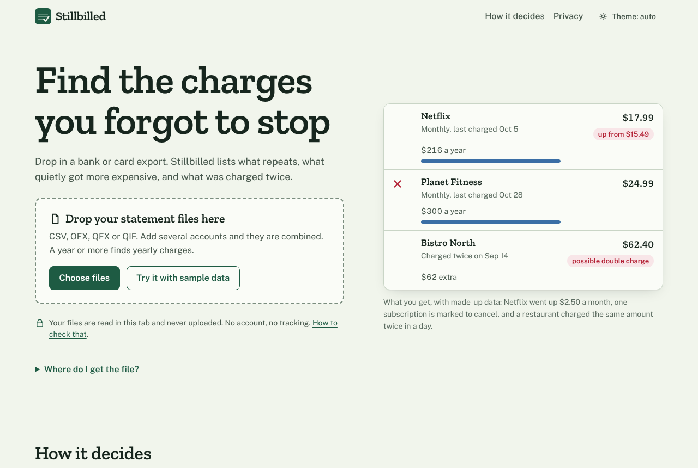
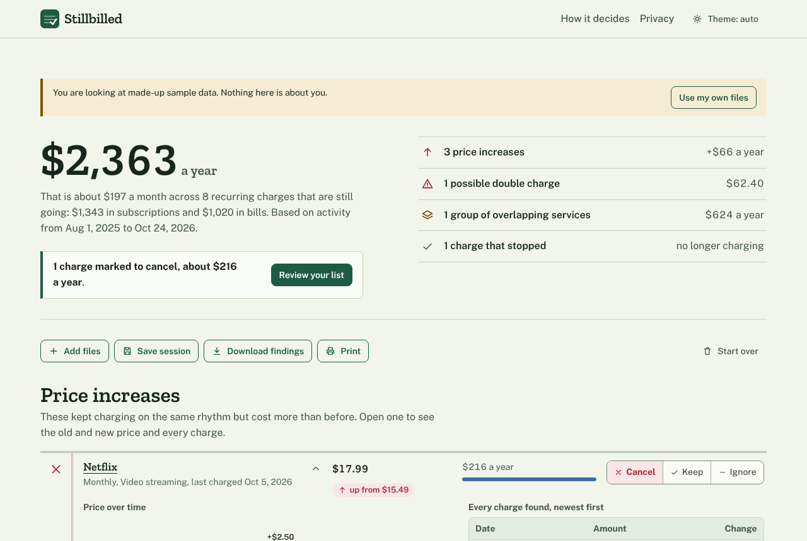
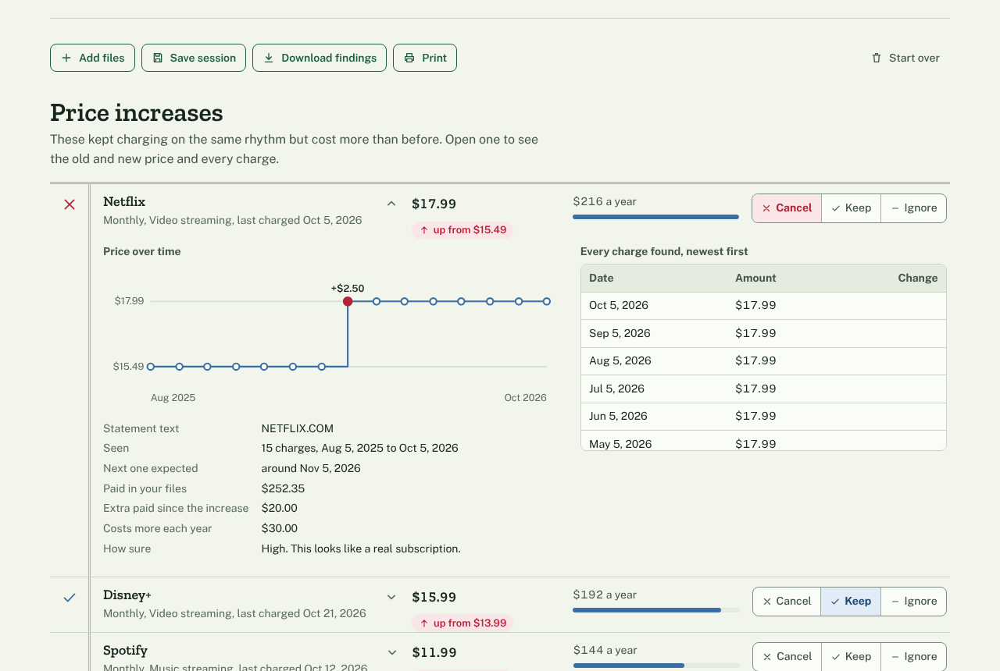
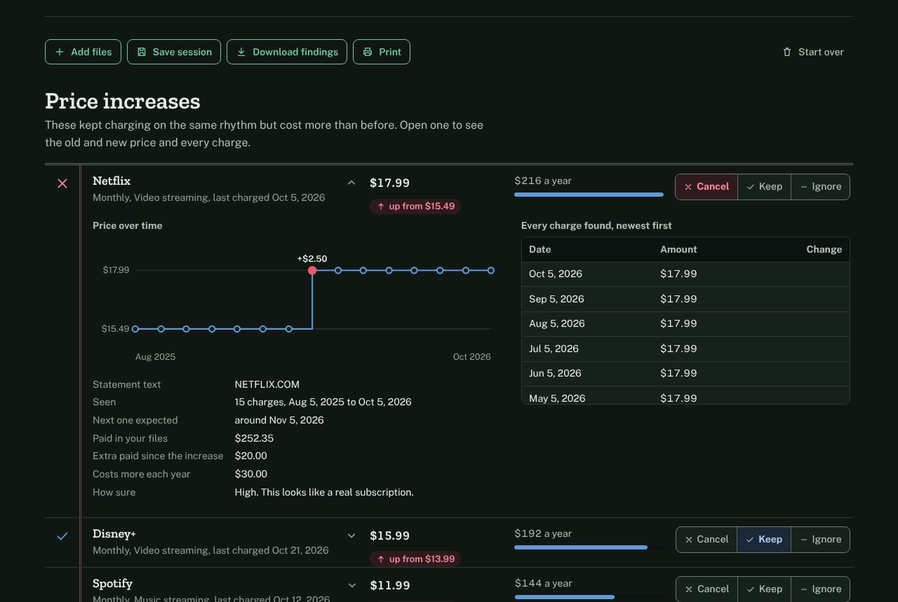
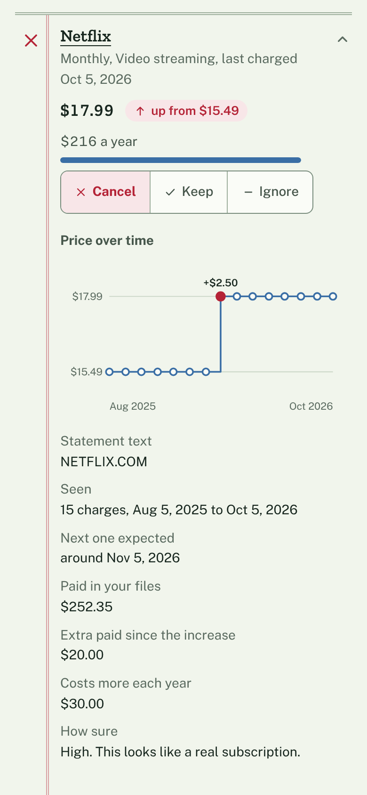

# Stillbilled

**Find the charges you forgot to stop.** Drop in a bank or card export and Stillbilled lists what repeats, what quietly went up in price, and what was charged twice. It runs entirely in your browser: no account, no bank login, no upload.

> **Try it:** once you have deployed this repository (see [Deploying to GitHub Pages](#deploying-to-github-pages)), the app is at `https://<your-user>.github.io/<your-repo>/`. Press **Try it with sample data** on the first screen to see every kind of finding without using your own files.



## Contents

1. [Purpose](#purpose) · 2. [The problem](#the-problem) · 3. [Who it is for](#who-it-is-for) · 4. [Why it matters](#why-it-matters) · 5. [Market research](#market-research-and-evidence) · 6. [Alternatives](#alternatives-and-how-this-differs) · 7. [Features](#core-features) · 8. [Screenshots](#screenshots) · 9. [Tech stack](#tech-stack-and-architecture) · 10. [Decisions](#important-decisions) · 11. [Privacy](#privacy-and-data-handling) · 12. [Local development](#local-development) · 13. [Testing](#testing) · 14. [Deploying](#deploying-to-github-pages) · 15. [Sub-paths](#repo-sub-path-and-asset-paths) · 16. [Limitations](#known-limitations-and-browser-compatibility) · 17. [Roadmap](#roadmap) · 18. [Contributing](#contributing) · 19. [License](#license)

**Documentation:** [`docs/RESEARCH.md`](docs/RESEARCH.md) (market research, sources, hypotheses) · [`docs/ARCHITECTURE.md`](docs/ARCHITECTURE.md) · [`docs/PRIVACY.md`](docs/PRIVACY.md) · [`docs/DESIGN.md`](docs/DESIGN.md) · [`docs/LAUNCH.md`](docs/LAUNCH.md) (launch and distribution plan) · [`CHANGELOG.md`](CHANGELOG.md) · [`CONTRIBUTING.md`](CONTRIBUTING.md) · [`NOTICE.md`](NOTICE.md) (ownership and licensing assumptions)

## Purpose

Stillbilled is a free, open-source audit of your own bank and card statements. You give it the files your bank already lets you download (CSV, OFX, QFX or QIF). It shows you:

- every **recurring charge**, with what it costs per year;
- every recurring charge whose **price went up**, with the old price, the new price and the yearly cost of the difference;
- **possible double charges**, and whether a refund followed;
- **overlapping services** (three video apps, say) and **charges that stopped**;
- a **cancel list** you build by marking each finding Cancel, Keep or Ignore, with the yearly saving.

It cannot cancel anything for you. Its job is to make the list.

## The problem

Subscriptions renew silently, prices creep up by a dollar or two, and a charge you stopped using can run for years. The usual fix is an app that asks for your bank login. Many people do not want that, and the free ones have a history of disappearing or of upselling you a subscription to manage your subscriptions. A bank statement already contains the answer; it is just hard to read at 400 lines a month.

## Who it is for

- People who suspect they pay for things they no longer use and want to check, once, without signing up for anything.
- People who will not link a bank account to a third party.
- People doing a yearly money tidy-up, a move, or a switch of bank, with a few statement files to hand.
- Household managers combining two or three accounts and cards into one view.

It is not for business accounting, investing, or budgeting. It does not track spending by category over time.

## Why it matters

Small recurring amounts are the easiest money to lose, because nothing prompts you to look at them. The evidence in `docs/RESEARCH.md` (survey figures about unused subscriptions and price rises, with the caveats about each source) suggests the problem is widespread, but those figures are survey answers, not measurements, and I have not verified how many people would act on a report like this. What the tool can do is cheap to check: you can see the answer in about a minute.

## Market research and evidence

A short summary. The full write-up, with sources, dates, source-quality notes and an explicit list of unverified hypotheses, is in [`docs/RESEARCH.md`](docs/RESEARCH.md). The research was a desk study on 2026-10-26: 22 web searches and fetches, no interviews or user testing.

What the research **verified** (as reported by the sources named in the research document):

- Surveys report that many people have forgotten or unused subscriptions and underestimate what they spend (Self Financial 2026, C+R Research, CNET). Some of those sources sell related products, and each is a self-report.
- The dominant way of finding subscriptions is bank linking through an aggregator such as Plaid (Rocket Money). Reviews repeat the same complaints: fees, hard-to-cancel plans, and discomfort at sharing bank credentials.
- Several "no bank linking" tools already exist, including a Chrome extension (ChargeSift) that does nearly the same job.

What it did **not** show: how large the group is that prefers a local tool, whether a web page beats an extension or app, or whether the heuristics hold on real accounts. These are listed as hypotheses H1 to H6 in the research document, with a way to test each.

## Alternatives and how this differs

| Alternative | Approach | How Stillbilled differs |
|-------------|----------|--------------------------|
| Rocket Money, Monarch and similar apps | Link your bank through an aggregator; paid tiers | No login, no account, no fee |
| **ChargeSift** (Chrome extension) | Local import of CSV, TSV, OFX, QFX, QIF; recurring, price rises and duplicates; encrypted local storage; separates currencies | The closest alternative. Stillbilled is a web page (nothing to install, works in any modern browser), keeps nothing after you close the tab, and adds a decision workflow (Cancel, Keep, Ignore), a cancel list, refund-aware double-charge detection and a price chart per item. ChargeSift handles several currencies at once and Stillbilled does not |
| Mobile apps such as Subscription Killer or SubFind | Statement photo or import | Runs on a desktop browser with a full file, no app store |
| Manual trackers and spreadsheets | You type each subscription in | Finds them for you |
| Email-scanning tools | Read your inbox for receipts | Does not need your inbox; finds charges receipts miss |
| Your bank's app | Sometimes lists recurring payments | Combines cards and accounts from different banks |

I used none of these products; what I know is from their public pages (see the research document). "Differs" means a design difference, not a quality claim.

## Core features

**Reads the files banks give you.** CSV (comma, semicolon or tab, with or without a header, split Debit and Credit columns, day-first or month-first dates, European decimals), OFX and QFX (old SGML-style and XML), QIF, and Stillbilled's own session files. Layouts modelled on Chase, Capital One, American Express and Bank of America exports are recognised, and the columns of others are inferred. You can correct the date order and the spending sign per file.

```
Transaction Date,Post Date,Description,Category,Type,Amount,Memo
09/14/2026,09/15/2026,SQ *BISTRO NORTH SEATTLE WA,Food & Drink,Sale,-62.40,
09/14/2026,09/15/2026,SQ *BISTRO NORTH SEATTLE WA,Food & Drink,Sale,-62.40,
```

**Combines several files.** Add every account and card. Overlapping exports (last 90 days, then last 180 days) are not double-counted, but two genuinely identical charges on one day are kept.

**Recurring charges.** Weekly, every two weeks, monthly, every two months, quarterly, every six months and yearly, with a few days' drift and one forgiven missed cycle. You can search, filter and sort the list, and open any row to see every charge behind it. Yearly cost is the latest price times how often it recurs.

**Price increases.** A recurring charge that continued on the same rhythm at a higher price is shown with the old price, the new price, the date, a step chart, and the yearly cost of the difference. With the bundled sample data, for example, Netflix goes from $15.49 to $17.99, which is $2.50 a month or $30 a year, and the sample's three increases come to $66 a year.

**Possible double charges.** The same merchant and amount (10.00 or more) within three days, not part of a pattern. If a matching refund arrives within 21 days it is marked as refunded. You can copy or download a dispute list.

**Overlaps and stopped charges.** Several active services in a category where people double up, and charges whose next payment is well overdue as of your newest transaction.

**Decisions and a cancel list.** Mark each finding Cancel, Keep or Ignore (buttons with icons and words, not colour alone). The page keeps a running total of the yearly saving and builds a cancel list you can copy as text or download as CSV.

**Save and reopen.** Save a session file and open it later, by file chooser or by dropping it on the page, with your marks intact. A findings CSV and a print stylesheet are included.

**Light and dark themes**, keyboard operation, screen-reader announcements, and a layout that works from a 360 px phone up.

## Screenshots

These were captured from the real build by the browser test suite (`npm run test:e2e -- --screenshots`), using the bundled made-up sample data.

| Results, desktop | One finding open, desktop |
|---|---|
|  |  |

| Dark theme | Phone |
|---|---|
|  |  |

## Tech stack and architecture

- Semantic HTML, modern CSS (custom properties, grid) and vanilla JavaScript in ES modules.
- **No runtime dependencies, no framework, no bundler.** The site served is the source, copied.
- Node 20 or later and two dev-only packages (`playwright`, `axe-core`) for tests. No other tooling.
- Two typefaces bundled in the repository (Zilla Slab and Public Sans, SIL Open Font License).

```
js/core/      audit engine: dates, money, merchants, merge, detection (pure, no DOM)
js/parsers/   CSV, OFX/QFX, QIF, session files, text decoding
js/ui/        glue and logic (pipeline, totals, export) and rendering (app, results, rows, chart, dialogs)
css/          tokens, base, app, print
scripts/      build, local server, site checker
tests/        unit tests, fixtures, browser tests
```

More in [`docs/ARCHITECTURE.md`](docs/ARCHITECTURE.md).

## Important decisions

- **Local-first with no persistence.** Nothing is stored except the theme. A session file is opt-in. Less to protect, and nothing to leak.
- **Rules, not a model.** The detection is explainable rules over rhythm and price plus a small brand table. Every finding shows the charges behind it, so you can overrule it. The engine prefers staying quiet to false alarms.
- **Integer cents and integer day numbers.** No floating-point money and no `Date` objects in the engine, so results do not depend on time zone or the clock. "Now" is the newest transaction in your files.
- **Text only into the page.** No `innerHTML` anywhere, and a strict Content-Security-Policy in the page. A bank file can put anything in a merchant name; it can only ever be shown as text.
- **No framework.** For a tool this size a framework adds more to trust and to maintain than it saves.
- **Colour is never the only signal.** The chart's two marks are blue and red. I checked a green and red pair with the colour-vision-deficiency simulation in the data-visualisation checker I used, and it failed (colour difference ΔE 3.7), so I did not use it. Every state also has an icon and words. See [`docs/DESIGN.md`](docs/DESIGN.md).
- **Relative URLs everywhere**, so it works under a GitHub Pages project path (see below).

## Privacy and data handling

Your files are read by JavaScript in your browser tab. They are never uploaded; there is no server code in this repository. The only thing stored in your browser is your theme choice. A saved session file contains your transactions, so treat it like the statement. The page ships a Content-Security-Policy that stops its scripts from making network connections, and a test confirms it. You can verify all of this yourself in a minute with the Network tab, or by going offline after the page loads.

Details, the limits of the Content-Security-Policy (it cannot stop navigation or set `frame-ancestors`), and a threat model are in [`docs/PRIVACY.md`](docs/PRIVACY.md).

## Local development

Requires Node 20 or later. The unit tests, build and site checker were run on Node 20.20 and Node 22.23; the browser tests only on Node 22.

```bash
git clone <your repository url>
cd stillbilled
npm install            # only needed for the browser tests
npm run serve          # http://127.0.0.1:8080/  (serves the source directly)
```

The source runs in the browser as it is, so there is nothing to compile. To try the built site, or to serve it under a sub-path the way GitHub Pages does:

```bash
npm run build                                           # writes dist/
node scripts/serve.mjs --dir dist --base /stillbilled/  # http://127.0.0.1:8080/stillbilled/
```

Do not open `index.html` by double-clicking it. Browsers block ES modules on `file://` pages, so use the small server.

Do not put real statements in the repository. `.gitignore` excludes `*.private.csv` and `my-statements/` for that reason.

## Testing

```bash
npm test               # 145 unit tests (Node's built-in test runner), about 2 seconds
npm run verify         # unit tests, then build, then the site checker
npx playwright install chromium   # once, for the next command
npm run test:e2e       # 34 browser tests against the built site
```

- **Unit tests** cover dates and money arithmetic, text decoding, the CSV, OFX and QIF parsers (using fixtures modelled on four US banks, a European semicolon file and an XML OFX file), merchant cleaning, the detection engine, merging, session files, the pipeline and the decision totals, plus the local server's path handling and the site checker itself (including a deliberately broken site it must reject). A randomised test builds 60 histories of everyday spending and asserts that nothing is flagged as a subscription.
- **The site checker** (`npm run check`) inspects `dist/` and fails on root-relative or external references, missing files, inline script or style, missing CSP, duplicate ids, broken in-page links, and any mention of a network API in the code.
- **Browser tests** run headless Chromium against the built site served under a sub-path and also at the root. They cover loading with no outside requests, the CSP blocking a `fetch`, every file format through the file chooser, drag and drop, multi-file merging, errors for PDFs and empty files, markup in merchant names being shown as text, saving and reopening a session, working with the network switched off after load, the theme, keyboard-only operation, no sideways scrolling at phone and tablet widths, print, and an [axe-core](https://github.com/dequelabs/axe-core) accessibility scan (WCAG 2.0 to 2.2 A and AA rules, plus axe's best-practice rules) in light and dark themes.

All of the above passed when I ran them on 2026-10-28. They run only in Chromium. See the limitations below.

## Deploying to GitHub Pages

1. Create a repository on GitHub and push this code to its `main` branch.
2. In the repository, go to **Settings, Pages**, and under **Build and deployment** set **Source** to **GitHub Actions**.
3. Push to `main` (or run the **Deploy to GitHub Pages** workflow from the Actions tab). The workflow in `.github/workflows/pages.yml` runs the tests, builds `dist/`, checks it, and publishes it.
4. When it finishes, the site is at `https://<your-user>.github.io/<your-repo>/`. The footer shows a "Source code on GitHub" link to your repository.

The workflow does not need any secret. A second workflow (`ci.yml`) runs the unit tests, the build, the checker and the browser tests on every pull request.

## Repo sub-path and asset paths

A project site on GitHub Pages is served from `/<repo>/`, not from `/`. A root-relative URL such as `/css/app.css` would then look in the wrong place and the page would load unstyled and broken. To avoid that:

- Every URL in `index.html`, CSS and JavaScript is **relative**: `css/app.css` in the page, `../assets/fonts/...` in the stylesheet, and relative `import` paths between modules.
- `scripts/check-site.mjs` fails the build if any reference starts with `/`, points at another site, or points at a file that is not in `dist/`.
- The browser tests serve the build under `/stillbilled-test/` and also at `/`, and fail if the page requests anything outside its own folder.
- `dist/` includes an empty `.nojekyll` file so GitHub Pages does not run Jekyll over the files.

If you use a custom domain, nothing changes, because the URLs are relative.

## Known limitations and browser compatibility

**Detection**

- Detection is a heuristic and can be wrong. In a simulation I ran on 2026-10-28, 800 generated histories of everyday spending with no subscriptions produced a false recurring charge in 2 of them (a coffee chain and a petrol station that happened to fit a monthly pattern) and a false double charge in 1. Those histories come from the same generator I tuned the rules against, so this is a sanity check and not independent evidence. Real accounts will behave differently. Every finding lists its charges and can be ignored.
- Detection finds the 8 recurring charges, the 1 stopped charge and the 2 double charges that are planted in the sample data in all 300 simulated variations of it. That generator is also mine, so it says the code does what I intended, not that it works on your bank.
- Several subscriptions billed under one name (an app store, for example) are separated only if their prices or dates differ.
- Irregular billing (usage-based bills, subscriptions that skip months) may be missed.

**Input**

- **No PDF support.** Download CSV, OFX or QFX instead.
- **One currency at a time**, with no conversion.
- The bank layouts were modelled on third-party descriptions and **tested only on synthetic fixtures**, not on real accounts. Real exports can differ, which is why you can correct the date order and spending sign per file. If a layout fails, please open an issue with a few made-up rows in the same shape.
- Parsing runs on the main thread, with a 30 MB limit per file. A very large file may freeze the tab briefly.

**Platform**

- **Browsers.** I tested only in headless Chromium (Playwright's bundled build). I did **not** test Firefox, Safari or any mobile browser. By my reading of the features used (ES modules, `<dialog>`, `color-mix()`, `dvh` units, CSS grid), it should work in browsers released since early 2023, but that is not tested.
- **Offline.** "Offline" means it keeps working after the page has loaded. There is no service worker, so it will not start from a cold offline load.
- **Not framed-proof.** A `<meta>` policy cannot set `frame-ancestors`, so another site could embed the page. See `docs/PRIVACY.md`.
- Screen-reader behaviour was checked with automated rules (axe-core) and by reasoning about the markup, not with a human using a screen reader.
- Not financial advice. Results are estimates for you to review.

## Roadmap

Realistic, in the order I would do them. None of this is promised.

1. Run the browser tests in Firefox and WebKit as well as Chromium, and fix what they find.
2. Move parsing and detection into a Web Worker so very large files never freeze the page.
3. Show several currencies separately instead of one at a time.
4. Collect anonymised, made-up-but-faithful sample layouts from users for more banks, and add them as fixtures.
5. Grow the known-brand table from reports of missed or wrongly grouped merchants.
6. An optional service worker so the page starts offline, if I can make updates safe.
7. Translate the interface (the parsers already read some non-English headers and European number formats).

Out of scope on purpose: accounts, sync, bank linking, analytics, and anything that sends your data anywhere.

## Contributing

Bug reports, bank-layout examples (made-up rows only), and pull requests are welcome. See [`CONTRIBUTING.md`](CONTRIBUTING.md) for how to run things, what a good change looks like, and how to report a privacy problem. Please never post real transactions.

## License

[MIT](LICENSE). The ownership and licensing assumptions are written out in [`NOTICE.md`](NOTICE.md). In short: the copyright line reads "Stillbilled contributors" because I do not know who will publish your copy, so replace it with your name or organisation before you publish if you want it to say that. The bundled fonts are under the SIL Open Font License (`assets/fonts/ZILLA-SLAB-OFL.txt` and `assets/fonts/PUBLIC-SANS-LICENSE.txt`). The name "Stillbilled" has had only a quick web search for conflicts and no trademark check (see `docs/RESEARCH.md`).
